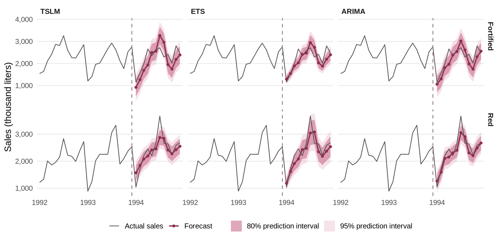

**Deployed Shiny app** : <https://sheshma-jaganathan.shinyapps.io/ads506-wine-forecasts/>

**Source code** : <https://github.com/SheshmaJ/australian-wine-sales-forecasting.git>

## App description

This Shiny app helps users explore Australian wine sales and compare TSLM, ETS, and ARIMA forecasts. Users can select wine types, adjust the training period, and check predictions against actual sales. Short explanations under the controls help users understand each setting.

The dashboard includes sales history, forecast charts, accuracy tables, and model specifications. Users can explore how sales changed over time, identify recurring seasonal patterns, and compare models using later sales data.

## App features

-   Select one or more wine types and a date range.

-   Explore sales over time and patterns by calendar month.

-   Change the training cutoff and forecast horizon.

-   Compare TSLM, ETS, and ARIMA for each selected wine type.

-   View actual sales alongside forecasts and 80% and 95% prediction intervals.

-   Compare training and validation RMSE, MAE, and MAPE.

-   View the model forms selected by ETS and ARIMA.

-   Download charts and accuracy tables.

## Data story

Different wine types needed different forecasting models. Fortified wine sales generally declined from 1980 to 1994, while red wine sales increased. Both showed repeated seasonal peaks and dips. These different patterns made me wonder whether the same forecasting model would work best for both wines.

I fitted TSLM, ETS, and ARIMA using sales from January 1980 through December 1993. I then compared their forecasts with actual sales for the 12 months of 1994. Keeping these later months outside the training period helped me check how well each model predicted new sales.

For fortified wine, ETS had the lowest validation RMSE at 318.90 thousand liters, followed by ARIMA at 328.50 and TSLM at 426.53. For red wine, ARIMA performed best at 257.86 thousand liters, compared with 297.16 for ETS and 319.28 for TSLM.

The training results showed why testing on later sales matters. ARIMA had the lowest training RMSE for fortified wine, but ETS performed best during validation. For red wine, ETS had the lowest training RMSE, while ARIMA performed best during validation. A close fit to past sales did not guarantee the most accurate forecasts for the following year.

Based on this validation year, I would choose ETS for fortified wine and ARIMA for red wine. Users can change the split in the app to see whether these rankings hold for another period.

## Forecast comparison

Figure 1 shows the three models alongside actual sales. Each column represents a forecasting model, and each row represents a wine type.

The dark lines show actual sales, and the pink lines show predictions. The dashed line marks the end of training in December 1993. Sales after that point provide a comparison with the forecasts for 1994.

The shaded bands show the 80% and 95% prediction intervals. The wider 95% band allows for a larger range of possible sales values. The chart helps users see where predictions follow seasonal changes and where they miss actual sales. The validation scores measure those errors across all 12 months.

{#fig-forecast width="100%"}

## Reproduce Figure 1

1.  Open **Forecast lab** and select **Fortified** and **Red**.
2.  Set **Sales dates** to **January 1980–December 1994** and **Last training month** to **December 1993**.
3.  Choose **12 months to predict**, select all three models, and show **24 months** of past sales.
4.  Open **Forecast** to recreate the figure or save the chart.
5.  Open **Accuracy** and select **Validation only** to check the reported RMSE values.